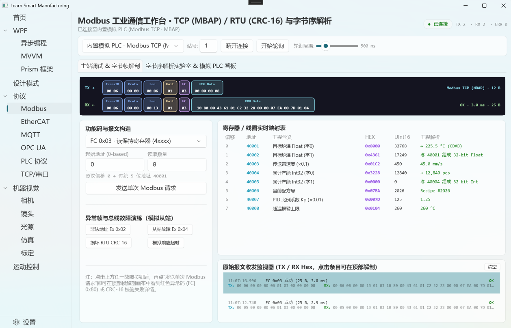
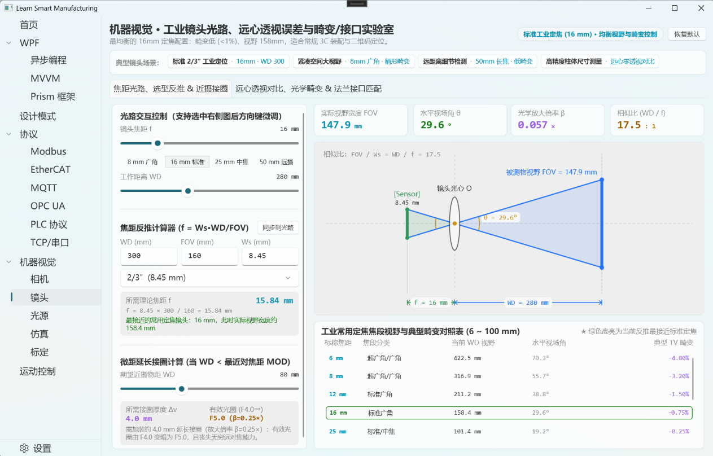

# LearnSmartManufacturing

面向智能制造 / 工业自动化上位机开发的 WPF 学习与实践项目，基于 **.NET 11 / WPF** 构建，结合 Fluent 主题、MVVM 与依赖注入，围绕工业现场常用技术逐步展开可视化学习工具与交互仿真。

## 软件截图





## 技术栈

- **.NET 11 / WPF**（`ThemeMode` Fluent 主题）
- **CommunityToolkit.Mvvm**（`ObservableObject`、`[ObservableProperty]`、`[RelayCommand]`）
- **Microsoft.Extensions.Hosting**（依赖注入与每页独立 `IServiceScope` 生命周期管理）
- **xUnit**（核心光学计算、ViewModel 与导航/主题服务单元测试）

## 构建与运行

```powershell
# 构建解决方案
dotnet build LearnSmartManufacturing.slnx

# 运行应用
dotnet run --project LearnSmartManufacturing/LearnSmartManufacturing.csproj

# 运行单元测试
dotnet test LearnSmartManufacturing.slnx
```
